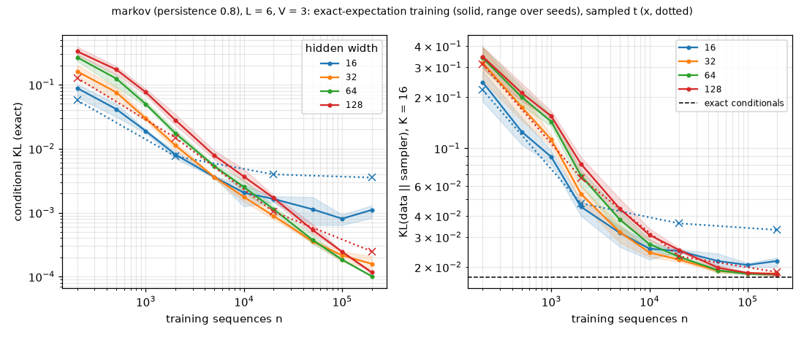

# masked-diffusion-lab

For masked (absorbing) discrete diffusion on data whose distribution is known exactly, how large is the error of a K-step parallel sampler that uses the exact conditionals, and how do sample size and model size change the error of a learned denoiser?

Sequences are short (length 6 over 3 symbols, length 8 over 2 symbols), so every sequence is enumerated and every error below is computed exactly, without Monte Carlo noise. CPU only, no GPU needed.

## Results

### 1. Sampler error with exact conditionals

Data laws: a cyclic Potts chain with coupling $\beta$ and a stationary Markov chain with persistence $\rho$. Both are product laws at 0 and more dependent as the parameter grows. The sampler runs on the uniform time grid: step $k$ of $K$ reveals every masked position with probability $1/(K-k)$, and the positions revealed in one step draw their tokens independently from the exact conditionals. `maskdiff.sampler` carries the exact law over the $(V+1)^L$ partial sequences through the steps. The tables give $\mathrm{KL}(\text{data} \,\|\, \text{sampler})$ in nats for $L = 6$, $V = 3$ (`results/sampler_error.json`).

| K | $\beta = 0.5$ | $\beta = 1$ | $\beta = 2$ |
|---|---|---|---|
| 1 (the total correlation) | 1.813e-01 | 7.631e-01 | 3.152e+00 |
| 2 | 4.352e-02 | 1.820e-01 | 7.844e-01 |
| 3 | 1.923e-02 | 8.161e-02 | 3.663e-01 |
| 4 | 1.080e-02 | 4.639e-02 | 2.165e-01 |
| 6 | 4.799e-03 | 2.093e-02 | 1.033e-01 |
| 8 | 2.700e-03 | 1.189e-02 | 6.091e-02 |
| 12 | 1.200e-03 | 5.345e-03 | 2.868e-02 |
| 16 | 6.755e-04 | 3.026e-03 | 1.669e-02 |
| 24 | 3.003e-04 | 1.354e-03 | 7.714e-03 |
| 32 | 1.690e-04 | 7.643e-04 | 4.435e-03 |
| 48 | 7.512e-05 | 3.410e-04 | 2.019e-03 |
| 6 steps, one position per step in random order | < 1e-15 | < 1e-15 | < 1e-15 |

For the product laws ($\beta = 0$ and $\rho = 0$) the KL is zero at every K (below 6e-15, rounding). The Markov chain behaves the same way:

| K | $\rho = 0.5$ | $\rho = 0.8$ | $\rho = 0.95$ |
|---|---|---|---|
| 1 (the total correlation) | 1.155e+00 | 3.068e+00 | 4.647e+00 |
| 2 | 2.737e-01 | 7.489e-01 | 1.188e+00 |
| 4 | 7.185e-02 | 2.108e-01 | 3.784e-01 |
| 8 | 1.898e-02 | 6.128e-02 | 1.258e-01 |
| 16 | 4.939e-03 | 1.751e-02 | 4.028e-02 |
| 48 | 5.672e-04 | 2.251e-03 | 5.941e-03 |
| 6 steps, one position per step in random order | < 1e-15 | < 1e-15 | < 1e-15 |


Log-log slope of KL against K. The required grid ends at K = 48, so the fit uses K from 16 to 48. That range is not yet asymptotic for strong dependence, so the study also evaluates K = 64 to 2048 and fits K from 512 to 2048. $c$ is the constant of formula (5) in `docs/derivations.md`, and the last column checks it against the exact program.

| L, V | law | total correlation | slope, K 16 to 48 | slope, K 512 to 2048 | $c$ | $K^2\,\mathrm{KL}$ at K = 2048 |
|---|---|---|---|---|---|---|
| 6, 3 | Potts 0.5 | 0.1813 | -1.999 | -2.000 | 0.1732 | 0.1732 |
| 6, 3 | Potts 1.0 | 0.7631 | -1.987 | -2.000 | 0.7919 | 0.7917 |
| 6, 3 | Potts 2.0 | 3.1518 | -1.923 | -1.997 | 4.9165 | 4.9094 |
| 6, 3 | Markov 0.5 | 1.1552 | -1.970 | -1.999 | 1.3320 | 1.3314 |
| 6, 3 | Markov 0.8 | 3.0676 | -1.867 | -1.993 | 5.8399 | 5.8193 |
| 6, 3 | Markov 0.95 | 4.6468 | -1.742 | -1.946 | 20.9083 | 20.1429 |
| 8, 2 | Potts 0.5 | 0.2425 | -1.994 | -2.000 | 0.2580 | 0.2580 |
| 8, 2 | Potts 1.0 | 0.8996 | -1.976 | -1.999 | 1.1067 | 1.1063 |
| 8, 2 | Potts 2.0 | 2.9638 | -1.909 | -1.996 | 5.9363 | 5.9258 |
| 8, 2 | Markov 0.5 | 0.9157 | -1.972 | -1.999 | 1.1602 | 1.1598 |
| 8, 2 | Markov 0.8 | 2.5764 | -1.890 | -1.995 | 5.2179 | 5.2053 |
| 8, 2 | Markov 0.95 | 4.0337 | -1.756 | -1.965 | 19.1571 | 18.7693 |

What the numbers show:

- At K = 1 the sampler returns the product of the marginals, and its KL equals the total correlation of the law (largest relative difference over the 12 dependent laws: 7e-15).
- Revealing one position per step in random order is exact: $|\mathrm{KL}| < 5 \cdot 10^{-16}$ for all 16 laws. The uniform grid with the same 6 steps is far from it, for example 2.093e-02 for $\beta = 1$ and 1.024e-01 for $\rho = 0.8$.
- The error falls like $1/K^2$, not $1/K$. For K from 512 to 2048 the slope is between -1.946 and -2.000. The error of the law itself is $O(1/K)$ and KL is quadratic in it, see formula (5).
- On the required grid (K 16 to 48) the slope is between -1.74 and -2.00. It is further from -2 for strong dependence because some two of the 6 positions still share a step with probability 0.656 at K = 16 and 0.278 at K = 48.
- $K^2\,\mathrm{KL}$ at K = 2048 is within 0.4% of $c$ for ten of the twelve laws, and within 3.7% (L = 6) and 2.0% (L = 8) for Markov 0.95, where the $O(1/K)$ corrections have a large constant.

Equal-size groups in random order, with K dividing L, against the uniform grid at the same K (L = 6, V = 3, KL in nats):

| K | schedule | $\beta = 0.5$ | $\beta = 1$ | $\beta = 2$ | $\rho = 0.95$ |
|---|---|---|---|---|---|
| 2 | uniform grid | 4.352e-02 | 1.820e-01 | 7.844e-01 | 1.188e+00 |
| 2 | equal groups | 2.784e-02 | 1.252e-01 | 8.777e-01 | 1.586e+00 |
| 3 | uniform grid | 1.923e-02 | 8.161e-02 | 3.663e-01 | 5.997e-01 |
| 3 | equal groups | 6.966e-03 | 3.393e-02 | 3.301e-01 | 6.543e-01 |

Equal groups are better for weak and moderate dependence, and worse for the strongest couplings at K = 2 ($\beta = 2$, $\rho = 0.95$) and for $\rho = 0.95$ at K = 3.

### 2. Learned denoiser

A two-hidden-layer MLP (ReLU, width 16, 32, 64 or 128) reads the one-hot code of a partial sequence, with the mask as an extra symbol, and returns one distribution per position. It is trained on $n$ sequences drawn from the data law, $n$ from 200 to 200000, with 3 seeds (the seed fixes the sample and the initialisation). The loss is the masked cross-entropy of section 1: $t$ uniform, mask rate $t$, weight $1/\max(t, 0.05)$. The main grid evaluates the expectation over $t$ and the mask pattern exactly, as a weighted cross-entropy on the 3367 partial sequences that hold a mask, and minimises it full batch with L-BFGS for 2000 iterations. A trainer that samples $t$ and the masks (Adam, batch 2048, 12000 steps) is in the library and ran on a sub-grid, see below.

Two errors, both exact. The conditional KL: draw $t$ uniformly and a mask pattern from the forward process, then average the KL between the true and the learned conditional over the masked positions (the ELBO gap divided by $L + 1$). And the KL of the K = 16 sampler that runs on the learned conditionals. Law: Markov chain with persistence 0.8, $L = 6$, $V = 3$ (entropy 3.524, total correlation 3.068). With the exact conditionals the K = 16 sampler has KL 1.751e-02. Everything below is in `results/denoiser_markov.json`.

Conditional KL, mean over 3 seeds (the seed to seed standard deviation over the mean is 0.14 in the median cell and 0.50 at most):

| n | width 16 | width 32 | width 64 | width 128 |
|---|---|---|---|---|
| 200 | 8.844e-02 | 1.613e-01 | 2.672e-01 | 3.309e-01 |
| 500 | 4.150e-02 | 7.595e-02 | 1.245e-01 | 1.724e-01 |
| 1000 | 1.888e-02 | 2.969e-02 | 4.968e-02 | 7.617e-02 |
| 2000 | 8.098e-03 | 1.125e-02 | 1.744e-02 | 2.798e-02 |
| 5000 | 3.600e-03 | 3.587e-03 | 5.325e-03 | 7.820e-03 |
| 10000 | 2.043e-03 | 1.759e-03 | 2.508e-03 | 3.658e-03 |
| 20000 | 1.640e-03 | 8.904e-04 | 1.135e-03 | 1.702e-03 |
| 50000 | 1.128e-03 | 3.553e-04 | 3.754e-04 | 5.369e-04 |
| 100000 | 8.047e-04 | 2.153e-04 | 1.838e-04 | 2.446e-04 |
| 200000 | 1.103e-03 | 1.585e-04 | 1.016e-04 | 1.170e-04 |

KL of the K = 16 sampler on the learned conditionals, mean over 3 seeds (exact conditionals: 1.751e-02):

| n | width 16 | width 32 | width 64 | width 128 |
|---|---|---|---|---|
| 200 | 2.459e-01 | 3.192e-01 | 3.414e-01 | 3.477e-01 |
| 500 | 1.254e-01 | 1.753e-01 | 2.005e-01 | 2.122e-01 |
| 1000 | 8.910e-02 | 1.126e-01 | 1.437e-01 | 1.547e-01 |
| 2000 | 4.533e-02 | 5.400e-02 | 6.908e-02 | 8.113e-02 |
| 5000 | 3.176e-02 | 3.209e-02 | 3.805e-02 | 4.404e-02 |
| 10000 | 2.565e-02 | 2.434e-02 | 2.729e-02 | 3.091e-02 |
| 20000 | 2.485e-02 | 2.211e-02 | 2.299e-02 | 2.518e-02 |
| 50000 | 2.169e-02 | 1.900e-02 | 1.912e-02 | 1.981e-02 |
| 100000 | 2.056e-02 | 1.837e-02 | 1.822e-02 | 1.847e-02 |
| 200000 | 2.172e-02 | 1.831e-02 | 1.810e-02 | 1.816e-02 |



Solid lines: exact-expectation training, band = range over seeds. Crosses with dotted lines: sampled-$t$ training (sub-grid). Dashed line: sampler KL with exact conditionals.

Log-log slope of the conditional KL against $n$ (least squares on the 3-seed means over the stated range of $n$):

| width | n 200 to 2000 | n 2000 to 20000 | n 20000 to 200000 | n 200 to 200000 |
|---|---|---|---|---|
| 16 | -1.04 | -0.71 | -0.21 | -0.69 |
| 32 | -1.16 | -1.10 | -0.76 | -1.06 |
| 64 | -1.19 | -1.18 | -1.05 | -1.19 |
| 128 | -1.07 | -1.21 | -1.16 | -1.20 |

What the numbers show:

- With few sequences, wider is worse. For $n \le 2000$ the error grows with width (n = 200: 8.8e-2 at width 16, 3.3e-1 at width 128), and at $n = 5000$ widths 16 and 32 tie. There is no regularisation and no early stopping, which is consistent with the wide networks interpolating the few training sequences.
- With many sequences the error falls like $n^{-1.1}$ to $n^{-1.2}$ for widths 32 to 128 (slopes over the whole range -1.06, -1.19, -1.20). Width 16 flattens near 1e-3 (slope -0.21 between 2e4 and 2e5), where its 2000 iterations are also not enough, see the budget table.
- Width at which the error stops improving, taken as the smallest width within 10% of the best mean: 16 for $n \le 5000$, 32 for $n$ from $10^4$ to $5 \cdot 10^4$, 64 for $n \ge 10^5$. Width 128 is never the best. At $n = 200000$ widths 64 and 128 differ by 1.0e-4 against 1.2e-4, inside the seed spread.
- The sampler cannot go below the discretisation floor. With learned conditionals the K = 16 KL never fell below the exact-conditional value 1.751e-02 (smallest ratio over the 120 runs: 1.003). For $n \ge 10^5$ and widths 32 to 128 all 18 runs are within 6.1% of it, so more data does not remove this error and more steps do (section 1). With 200 sequences the sampler KL is 14 to 20 times the floor.

Sampled $t$ against the exact expectation, mean over 3 seeds (sampled: Adam, batch 2048, 12000 steps; sub-grid of widths 16 and 128):

| width | n | cond KL exact | cond KL sampled | K = 16 exact | K = 16 sampled |
|---|---|---|---|---|---|
| 16 | 200 | 8.844e-02 | 5.701e-02 | 2.459e-01 | 2.211e-01 |
| 16 | 2000 | 8.098e-03 | 7.610e-03 | 4.533e-02 | 4.748e-02 |
| 16 | 20000 | 1.640e-03 | 3.963e-03 | 2.485e-02 | 3.617e-02 |
| 16 | 200000 | 1.103e-03 | 3.532e-03 | 2.172e-02 | 3.308e-02 |
| 128 | 200 | 3.309e-01 | 1.276e-01 | 3.477e-01 | 3.140e-01 |
| 128 | 2000 | 2.798e-02 | 1.481e-02 | 8.113e-02 | 6.720e-02 |
| 128 | 20000 | 1.702e-03 | 1.033e-03 | 2.518e-02 | 2.314e-02 |
| 128 | 200000 | 1.170e-04 | 2.487e-04 | 1.816e-02 | 1.867e-02 |

Both trainers show the same shape: wide networks are worse with few sequences and better with many. They differ in size by up to a factor 3.2. For width 128 sampled-$t$ training gives the lower error up to $n = 20000$ and the higher one at $n = 200000$. For width 16 it gives the higher error from $n = 20000$ on, and tripling its steps lowers that error (budget table below).

Budget check, seed 0 only, each cell against a run three times as long (exact: L-BFGS iterations, 2000 against 6000; sampled: Adam steps, 12000 against 36000):

| trainer | width | n | cond KL | cond KL, 3x budget |
|---|---|---|---|---|
| exact | 16 | 2000 | 6.996e-03 | 7.007e-03 |
| exact | 128 | 2000 | 2.325e-02 | 4.031e-02 |
| exact | 16 | 200000 | 1.192e-03 | 8.919e-04 |
| exact | 128 | 200000 | 1.217e-04 | 1.644e-04 |
| sampled | 16 | 2000 | 7.096e-03 | 6.635e-03 |
| sampled | 128 | 2000 | 1.339e-02 | 2.928e-02 |
| sampled | 16 | 200000 | 3.624e-03 | 2.014e-03 |
| sampled | 128 | 200000 | 2.620e-04 | 1.745e-04 |

A longer run lowers the error of narrow networks at large $n$, which are still improving, and raises the error of wide networks, which is consistent with them fitting the sampling noise of the training sequences.

A second law, the Potts ring with coupling 1.0 (entropy 5.829, total correlation 0.763, K = 16 KL with exact conditionals 3.026e-03), with the exact trainer only (`results/denoiser_potts.json`, figure `results/denoiser_potts.png`). Conditional KL, mean over 3 seeds (seed to seed standard deviation over the mean: 0.06 in the median cell, 0.34 at most):

| n | width 16 | width 32 | width 64 | width 128 |
|---|---|---|---|---|
| 200 | 1.506e-01 | 2.441e-01 | 5.131e-01 | 1.034e+00 |
| 500 | 4.533e-02 | 9.048e-02 | 1.530e-01 | 3.403e-01 |
| 1000 | 2.154e-02 | 3.580e-02 | 5.827e-02 | 1.075e-01 |
| 2000 | 1.117e-02 | 1.632e-02 | 2.548e-02 | 4.135e-02 |
| 5000 | 4.790e-03 | 5.879e-03 | 8.502e-03 | 1.156e-02 |
| 10000 | 2.455e-03 | 2.644e-03 | 3.605e-03 | 4.916e-03 |
| 20000 | 1.718e-03 | 1.170e-03 | 1.651e-03 | 2.291e-03 |
| 50000 | 1.160e-03 | 3.756e-04 | 5.491e-04 | 8.204e-04 |
| 100000 | 1.215e-03 | 2.163e-04 | 2.646e-04 | 3.894e-04 |
| 200000 | 1.246e-03 | 1.344e-04 | 1.319e-04 | 1.871e-04 |

Log-log slopes against $n$ for the same runs:

| width | n 200 to 2000 | n 2000 to 20000 | n 20000 to 200000 | n 200 to 200000 |
|---|---|---|---|---|
| 16 | -1.13 | -0.83 | -0.13 | -0.71 |
| 32 | -1.19 | -1.14 | -0.94 | -1.12 |
| 64 | -1.31 | -1.19 | -1.10 | -1.20 |
| 128 | -1.42 | -1.26 | -1.09 | -1.26 |

The picture matches the Markov chain: wider is worse up to $n = 10^4$ (n = 200: 0.15 at width 16, 1.03 at width 128), slopes of -1.1 to -1.3 for widths 32 and above, and width 16 flattens near 1.2e-3. The smallest width within 10% of the best mean is 16 for $n \le 10^4$ and 32 for $n \ge 2 \cdot 10^4$, widths 32 and 64 tie at $n = 200000$, and width 128 is never the best. The $K = 16$ floor is small for this law, so the learned error shows in the sampler: at $n = 200$ its KL is 148 to 388 times the exact-conditional value, at $n = 200000$ it is 1.10, 1.13, 1.24 and 1.95 times that value for widths 32, 64, 128 and 16, and over the 120 runs it never fell below it (smallest ratio 1.065).


## What is in the repo

```
src/maskdiff/laws.py          data laws (Markov chain, Potts ring), entropy, total correlation
src/maskdiff/partial.py       partial sequences, exact marginals and conditionals, forward masking
src/maskdiff/elbo.py          negative ELBO in closed form, clipped weights, expected-loss targets
src/maskdiff/sampler.py       exact K-step sampler law (dynamic program), Monte Carlo sampler
src/maskdiff/asymptotics.py   tie probability and the large-K coefficient
src/maskdiff/metrics.py       KL, log-log slope, exact error of model conditionals
src/maskdiff/denoiser.py      MLP denoiser, exact-expectation and sampled-t training
scripts/                      sampler_error.py, denoiser_study.py, report.py
tests/                        the checks listed below, 10 to 20 s on a laptop
results/                      the JSON and PNG files that the tables above come from
docs/derivations.md           the derivations
```

The tests check, among others: enumerated laws sum to 1; the forward masking rate is $t$; the closed-form negative ELBO against the pattern sum integrated over $t$ and against the average over orderings, and its equality with $-\log p(x)$ for exact conditionals; the sampler law sums to 1, equals the data law for product laws and for one position per step, equals the product of marginals at K = 1, equals an explicit sum over reveal steps, and matches $10^6$ simulated sequences; the discrete-time ELBO of the sampler against its Riemann sum and against $\log q_K$; the large-K coefficient against the program up to K = 2048; the training loss against its exact expectation; the exact error measures against explicit sums.

## Reproduce

CPU only. Python 3.11 or newer (CI runs 3.11 and 3.12).

```
pip install torch --index-url https://download.pytorch.org/whl/cpu
pip install -e ".[dev]"
pytest -q
python scripts/sampler_error.py                                   # about 3 min, writes results/sampler_error.*
python scripts/denoiser_study.py --law markov --workers 5         # about 25 min with 5 workers
python scripts/denoiser_study.py --law potts --workers 5 --skip-sampled --skip-checks   # about 12 min
python scripts/report.py                                          # prints the tables of this page
```

The times are from a laptop that other jobs were using (load average 4.5, 10.7 and 22 when the three runs ended). Every training run is seeded and deterministic on one CPU thread, so a rerun gives the same numbers up to floating point.

## Method notes

- Laws. Markov chain: uniform start, a token repeats its predecessor with probability $\rho + (1-\rho)/V$ and moves to each other symbol with probability $(1-\rho)/V$. Potts ring: $p(x) \propto \exp(\beta\,\#\{i : x_i = x_{i+1 \bmod L}\})$, which for $V = 2$ is the Ising ring with coupling $\beta/2$.
- Forward process: each token is masked with probability $t$ (that is $\alpha_t = 1 - t$). Exact conditionals come from the table of all $(V+1)^L$ partial marginals of the enumerated law.
- Sampler: step $k$ reveals each masked position with probability $1/(K-k)$, and tokens revealed together are drawn from the conditionals given the partial sequence at the start of the step. A step is a sparse map with $(2V+1)^L$ moves. "One position per step in random order" is $L$ steps, each revealing one uniformly chosen masked position. "Equal groups" reveals $L/K$ uniformly chosen positions per step and is only defined for K dividing L.
- KL is $\mathrm{KL}(\text{data} \,\|\, \text{sampler})$, computed as $\sum_x p\,\log(1 + (p - q)/q)$ where $|p - q| \le q/2$, which stays accurate for nearby laws, and as $\sum_x p\,(\log p - \log q)$ elsewhere (the first form rounds to $-\infty$ when $q$ is far above $p$). Bins with $p = 0$ do not count, and $q = 0$ where $p > 0$ gives infinity. Values below 1e-14 are rounding.
- Slope fits are least squares of $\log \mathrm{KL}$ on $\log K$ over the stated range. The extra grid K = 64 to 2048 is an addition to the required one.
- Conditional KL: draw $t$ uniformly and a mask pattern from the forward process, then average the KL between the true and the learned conditional over the masked positions. It equals the ELBO gap (expected loss minus entropy) divided by $L + 1$.
- Denoiser: input is the one-hot code of each position over $V + 1$ symbols (the mask is symbol $V$), two hidden ReLU layers of the stated width, output is $L \times V$ logits, one softmax per position. The loss counts masked positions only.
- Training objective: $t$ uniform, mask rate $t$, weight $1/\max(t, 0.05)$ on $n$ sequences drawn from the data law. The main grid evaluates the expectation over $t$ and the mask pattern exactly and minimises it with L-BFGS (full batch, 2000 iterations, float64), so training has no sampling noise. Earlier runs with sampled $t$ and smaller batches and fewer steps (batch 512, 8000 steps), and a probe at $n = 200000$, were limited by optimisation at large $n$. That is why the main grid uses the exact expectation and why the sampled-$t$ trainer has the settings above (Adam, batch 2048, 12000 steps, learning rate 3e-3 with cosine decay to 3e-5). Those earlier runs are not part of the repo.
- No validation set and no early stopping, and the exact error is not used for any choice except the training method just described. The data law is the test.
- "Width at which the error stops improving": the smallest width whose mean error over the 3 seeds is within 10% of the best width at that $n$. Slopes are fitted to the means over seeds on the stated ranges of $n$.

Derivations in six lines (`docs/derivations.md`):

1. The negative ELBO with the linear schedule is $\int_0^1 \frac{1}{t}\,\mathbb{E}[\text{masked cross-entropy}]\,dt = \sum_{M \neq \emptyset} \frac{(|M|-1)!\,(L-|M|)!}{L!} \sum_{i \in M} -\log q_i(x^i \mid x_{M^c})$, the chain-rule loss averaged over orderings.
2. Its minimiser is the exact conditional of each masked token given the unmasked ones. With exact conditionals it equals $-\log p(x)$ for every $x$, and in general the expected loss is $H(p)$ plus a weighted conditional KL.
3. In the K-step sampler every position is revealed at an independent uniform step. K = 1 returns the product of the marginals, with error equal to the total correlation.
4. If no two positions share a step, or if one position is revealed per step in random order, the output law is the data law.
5. The law is $(1-\epsilon_K)\,p + \epsilon_K\, r_K$ with $\epsilon_K \le L(L-1)/(2K)$, so $\mathrm{KL} = O(K^{-2})$.
6. The leading term is $c/K^2$ with $c$ built from pairwise pointwise mutual information given random subsets (formula (5)), and the exact program reproduces it up to K = 2048.

## Limits

- Sequences have length 6 or 8 over 2 or 3 symbols and the laws are two simple families. Nothing here says how the numbers move for long sequences, large alphabets or real data.
- The sampler analysis covers the uniform time grid with independent reveals, and equal groups in random order. Other schedules, confidence-based ordering and remasking samplers are not studied. The formula for $c$ needs $p > 0$ and is checked numerically, not proved beyond the $O(K^{-2})$ bound.
- The denoiser results come from one architecture family, one loss weighting, 3 seeds and no regularisation. Slopes are fits to 3-seed means with a seed to seed spread of up to 50%, so differences of 0.1 in slope mean little. These are measurements on small cases, not a theorem.
- The training length matters. Tripling it moved single-seed errors by up to a factor 2.2, and wide networks fit the sampling noise of the training sequences longer, so the small-$n$ numbers describe the stated budget and not the best possible training.
- The main grid uses the exact expectation of the loss, not sampled $t$. The sampled-$t$ trainer ran on 2 widths and 4 sample sizes and gave errors that differ from the exact one by up to a factor 3.2, so the quantitative values depend on the training recipe.
- The Potts law was run with the exact trainer only, without budget checks.

## License

Apache-2.0, see `LICENSE`.
