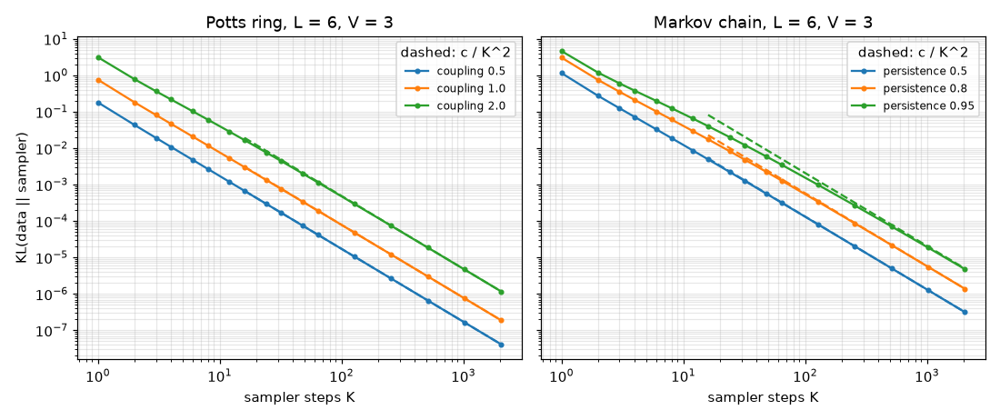
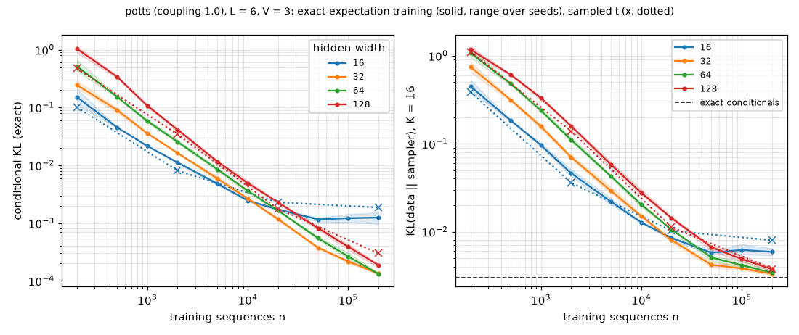

# masked-diffusion-lab

For masked (absorbing) discrete diffusion on data whose distribution is known exactly, how large is the error of a K-step parallel sampler that uses the exact conditionals, and how do sample size and model size change the error of a learned denoiser?

Sequences are short (length 6 over 3 symbols, length 8 over 2 symbols), so every sequence is enumerated and every error below is computed exactly, without Monte Carlo noise. CPU only, no GPU needed.

## Results

### 1. Sampler error with exact conditionals

Data laws: a cyclic Potts chain with coupling $\beta$ and a stationary Markov chain with persistence $\rho$. Both are product laws at 0 and more dependent as the parameter grows. The sampler runs on the uniform time grid: step $k$ of $K$ reveals every masked position with probability $1/(K-k)$, and the positions revealed in one step draw their tokens independently from the exact conditionals. `maskdiff.sampler` carries the exact law over the $(V+1)^L$ partial sequences through the steps. The tables give $\mathrm{KL}(\text{data} \,\|\, \text{sampler})$ in nats for $L = 6$, $V = 3$ (`results/sampler_error.json`).

| K | $\beta = 0.5$ | $\beta = 1$ | $\beta = 2$ |
|---|---|---|---|
| 1 (the total correlation) | 1.813e-01 | 7.631e-01 | 3.152e+00 |
| 2 | 4.352e-02 | 1.820e-01 | 7.844e-01 |
| 3 | 1.923e-02 | 8.161e-02 | 3.663e-01 |
| 4 | 1.080e-02 | 4.639e-02 | 2.165e-01 |
| 6 | 4.799e-03 | 2.093e-02 | 1.033e-01 |
| 8 | 2.700e-03 | 1.189e-02 | 6.091e-02 |
| 12 | 1.200e-03 | 5.345e-03 | 2.868e-02 |
| 16 | 6.755e-04 | 3.026e-03 | 1.669e-02 |
| 24 | 3.003e-04 | 1.354e-03 | 7.714e-03 |
| 32 | 1.690e-04 | 7.643e-04 | 4.435e-03 |
| 48 | 7.512e-05 | 3.410e-04 | 2.019e-03 |
| 6 steps, one position per step in random order | < 1e-15 | < 1e-15 | < 1e-15 |

For the product laws ($\beta = 0$ and $\rho = 0$) the KL is zero at every K (largest $|\mathrm{KL}|$ 5.7e-15, rounding). The Markov chain behaves the same way:

| K | $\rho = 0.5$ | $\rho = 0.8$ | $\rho = 0.95$ |
|---|---|---|---|
| 1 (the total correlation) | 1.155e+00 | 3.068e+00 | 4.647e+00 |
| 2 | 2.737e-01 | 7.489e-01 | 1.188e+00 |
| 4 | 7.185e-02 | 2.108e-01 | 3.784e-01 |
| 8 | 1.898e-02 | 6.128e-02 | 1.258e-01 |
| 16 | 4.939e-03 | 1.751e-02 | 4.028e-02 |
| 48 | 5.672e-04 | 2.251e-03 | 5.941e-03 |
| 6 steps, one position per step in random order | < 1e-15 | < 1e-15 | < 1e-15 |



Log-log slope of KL against K. The required grid ends at K = 48, so the fit uses K from 16 to 48. That range is not yet asymptotic for strong dependence, so the study also evaluates K = 64 to 2048 and fits K from 512 to 2048. $c$ is the constant of formula (5) in `docs/derivations.md`, and the last column checks it against the exact program.

| L, V | law | total correlation | slope, K 16 to 48 | slope, K 512 to 2048 | $c$ | $K^2\,\mathrm{KL}$ at K = 2048 |
|---|---|---|---|---|---|---|
| 6, 3 | Potts 0.5 | 0.1813 | -1.999 | -2.000 | 0.1732 | 0.1732 |
| 6, 3 | Potts 1.0 | 0.7631 | -1.987 | -2.000 | 0.7919 | 0.7917 |
| 6, 3 | Potts 2.0 | 3.1518 | -1.923 | -1.997 | 4.9165 | 4.9094 |
| 6, 3 | Markov 0.5 | 1.1552 | -1.970 | -1.999 | 1.3320 | 1.3314 |
| 6, 3 | Markov 0.8 | 3.0676 | -1.867 | -1.993 | 5.8399 | 5.8193 |
| 6, 3 | Markov 0.95 | 4.6468 | -1.742 | -1.946 | 20.9083 | 20.1429 |
| 8, 2 | Potts 0.5 | 0.2425 | -1.994 | -2.000 | 0.2580 | 0.2580 |
| 8, 2 | Potts 1.0 | 0.8996 | -1.976 | -1.999 | 1.1067 | 1.1063 |
| 8, 2 | Potts 2.0 | 2.9638 | -1.909 | -1.996 | 5.9363 | 5.9258 |
| 8, 2 | Markov 0.5 | 0.9157 | -1.972 | -1.999 | 1.1602 | 1.1598 |
| 8, 2 | Markov 0.8 | 2.5764 | -1.890 | -1.995 | 5.2179 | 5.2053 |
| 8, 2 | Markov 0.95 | 4.0337 | -1.756 | -1.965 | 19.1571 | 18.7693 |

What the numbers show:

- At K = 1 the sampler returns the product of the marginals, and its KL equals the total correlation of the law (largest relative difference over the 12 dependent laws: 7e-15).
- Revealing one position per step in random order is exact: the largest $|\mathrm{KL}|$ over the 16 laws is 4.7e-16 (rounding). The uniform grid with the same 6 steps is far from it, for example 2.093e-02 for $\beta = 1$ and 1.024e-01 for $\rho = 0.8$.
- The error falls like $1/K^2$, not $1/K$. For K from 512 to 2048 the slope is between -1.946 and -2.000. The error of the law itself is $O(1/K)$ and KL is quadratic in it, see formula (5).
- On the required grid (K 16 to 48) the slope is between -1.74 and -2.00, and it is further from -2 for strong dependence. The chance that some two of the 6 positions share a step (0.656 at K = 16, 0.278 at K = 48) is the same for every law, so it sets the scale of the correction but not its size between laws. The size comes from the $O(1/K)$ term, whose constant grows with the dependence.
- $K^2\,\mathrm{KL}$ at K = 2048 is within 0.4% of $c$ for ten of the twelve laws, and within 3.7% (L = 6) and 2.0% (L = 8) for Markov 0.95, where the $O(1/K)$ corrections have a large constant.

Equal-size groups in random order, with K dividing L, against the uniform grid at the same K (L = 6, V = 3, KL in nats):

| K | schedule | $\beta = 0.5$ | $\beta = 1$ | $\beta = 2$ | $\rho = 0.95$ |
|---|---|---|---|---|---|
| 2 | uniform grid | 4.352e-02 | 1.820e-01 | 7.844e-01 | 1.188e+00 |
| 2 | equal groups | 2.784e-02 | 1.252e-01 | 8.777e-01 | 1.586e+00 |
| 3 | uniform grid | 1.923e-02 | 8.161e-02 | 3.663e-01 | 5.997e-01 |
| 3 | equal groups | 6.966e-03 | 3.393e-02 | 3.301e-01 | 6.543e-01 |

Equal groups are better for weak and moderate dependence, and worse for the strongest couplings at K = 2 ($\beta = 2$, $\rho = 0.95$) and for $\rho = 0.95$ at K = 3.

### 2. Learned denoiser

A two-hidden-layer MLP (ReLU, width 16, 32, 64 or 128) reads the one-hot code of a partial sequence, with the mask as an extra symbol, and returns one distribution per position. It is trained on $n$ sequences drawn from the data law, $n$ from 200 to 200000, with 3 seeds (the seed fixes the sample and the initialisation). The training loss is the masked cross-entropy derived in `docs/derivations.md` (parts 1 and 2): $t$ uniform, mask rate $t$, weight $1/\max(t, 0.05)$. The main grid takes its expectation over $t$ and the mask pattern exactly, and over the sequences under the empirical law of the $n$ training sequences, so it is a weighted cross-entropy on the 3367 partial sequences that hold a mask. It is minimised full batch with L-BFGS for at most 2000 iterations, and its minimiser is the plug-in conditional frequency of the training sequences (`elbo.minimum_loss` is the loss there). A trainer that samples $t$ and the masks (Adam, batch 2048, 12000 steps) is in the library and ran on a sub-grid, see below.

Two errors, both exact. The conditional KL: draw $t$ uniformly and a mask pattern from the forward process, then average the KL between the true and the learned conditional over the masked positions (the ELBO gap divided by $L + 1$). And the KL of the K = 16 sampler that runs on the learned conditionals. Both use the unclipped ELBO weights, while training uses the clipped weight, so the training loss is not the ELBO for $t$ below 0.05. As a non-neural reference, the plug-in table holds the conditional frequencies of the same $n$ training sequences with $\alpha$ added to every count (contexts that no sequence reaches get uniform conditionals). $\alpha$ = 0.01, 0.1 and 1 were fixed before any run, all three are reported, and none was chosen on the errors (`scripts/baseline.py`, `results/baseline.json`). Law: Markov chain with persistence 0.8, $L = 6$, $V = 3$ (entropy 3.524, total correlation 3.068). With the exact conditionals the K = 16 sampler has KL 1.751e-02, called the exact-conditional value below. Everything below, up to the second law, is in `results/denoiser_markov.json` and `results/baseline.json`.

Conditional KL, mean over 3 seeds, with the plug-in tables built on the same samples (for the networks, the relative standard deviation over the 3 seeds, sd/mean, is 0.14 in the median cell and 0.50 at most):

| n | width 16 | width 32 | width 64 | width 128 | plug-in 0.01 | plug-in 0.1 | plug-in 1 |
|---|---|---|---|---|---|---|---|
| 200 | 8.844e-02 | 1.613e-01 | 2.672e-01 | 3.309e-01 | 8.297e-02 | 4.946e-02 | 6.142e-02 |
| 500 | 4.150e-02 | 7.595e-02 | 1.245e-01 | 1.724e-01 | 6.130e-02 | 3.472e-02 | 3.418e-02 |
| 1000 | 1.888e-02 | 2.969e-02 | 4.968e-02 | 7.617e-02 | 4.429e-02 | 2.551e-02 | 2.280e-02 |
| 2000 | 8.098e-03 | 1.125e-02 | 1.744e-02 | 2.798e-02 | 2.348e-02 | 1.373e-02 | 1.308e-02 |
| 5000 | 3.600e-03 | 3.587e-03 | 5.325e-03 | 7.820e-03 | 1.000e-02 | 5.939e-03 | 6.152e-03 |
| 10000 | 2.043e-03 | 1.759e-03 | 2.508e-03 | 3.658e-03 | 6.635e-03 | 3.904e-03 | 3.558e-03 |
| 20000 | 1.640e-03 | 8.904e-04 | 1.135e-03 | 1.702e-03 | 4.052e-03 | 2.448e-03 | 2.000e-03 |
| 50000 | 1.128e-03 | 3.553e-04 | 3.754e-04 | 5.369e-04 | 1.376e-03 | 9.349e-04 | 8.630e-04 |
| 100000 | 8.047e-04 | 2.153e-04 | 1.838e-04 | 2.446e-04 | 7.319e-04 | 4.775e-04 | 4.253e-04 |
| 200000 | 1.103e-03 | 1.585e-04 | 1.016e-04 | 1.170e-04 | 4.084e-04 | 2.724e-04 | 2.255e-04 |

KL of the K = 16 sampler on the learned conditionals, mean over 3 seeds (exact conditionals: 1.751e-02):

| n | width 16 | width 32 | width 64 | width 128 | plug-in 0.01 | plug-in 0.1 | plug-in 1 |
|---|---|---|---|---|---|---|---|
| 200 | 2.459e-01 | 3.192e-01 | 3.414e-01 | 3.477e-01 | 3.421e-01 | 2.783e-01 | 4.045e-01 |
| 500 | 1.254e-01 | 1.753e-01 | 2.005e-01 | 2.122e-01 | 2.243e-01 | 1.798e-01 | 2.238e-01 |
| 1000 | 8.910e-02 | 1.126e-01 | 1.437e-01 | 1.547e-01 | 1.704e-01 | 1.434e-01 | 1.634e-01 |
| 2000 | 4.533e-02 | 5.400e-02 | 6.908e-02 | 8.113e-02 | 9.149e-02 | 8.027e-02 | 1.003e-01 |
| 5000 | 3.176e-02 | 3.209e-02 | 3.805e-02 | 4.404e-02 | 5.060e-02 | 4.660e-02 | 5.995e-02 |
| 10000 | 2.565e-02 | 2.434e-02 | 2.729e-02 | 3.091e-02 | 3.714e-02 | 3.512e-02 | 4.204e-02 |
| 20000 | 2.485e-02 | 2.211e-02 | 2.299e-02 | 2.518e-02 | 2.974e-02 | 2.886e-02 | 3.241e-02 |
| 50000 | 2.169e-02 | 1.900e-02 | 1.912e-02 | 1.981e-02 | 2.180e-02 | 2.168e-02 | 2.383e-02 |
| 100000 | 2.056e-02 | 1.837e-02 | 1.822e-02 | 1.847e-02 | 1.960e-02 | 1.956e-02 | 2.074e-02 |
| 200000 | 2.172e-02 | 1.831e-02 | 1.810e-02 | 1.816e-02 | 1.878e-02 | 1.878e-02 | 1.941e-02 |


Solid lines: exact-expectation training, band = range over seeds. Crosses with dotted lines: sampled-$t$ training (sub-grid). Dashed line: sampler KL with exact conditionals.

Log-log slope of the conditional KL against $n$ (least-squares fits to the 3-seed means over the stated range of $n$; descriptive fits, not a test of a power law):

| width | n 200 to 2000 | n 2000 to 20000 | n 20000 to 200000 | n 200 to 200000 |
|---|---|---|---|---|
| 16 | -1.04 | -0.71 | -0.21 | -0.69 |
| 32 | -1.16 | -1.10 | -0.76 | -1.06 |
| 64 | -1.19 | -1.18 | -1.05 | -1.19 |
| 128 | -1.07 | -1.21 | -1.16 | -1.20 |

What the numbers show:

- With few sequences, wider is worse. For $n \le 2000$ the error grows with width (n = 200: 8.8e-2 at width 16, 3.3e-1 at width 128), and at $n = 5000$ widths 16 and 32 tie. Two measurements bear on the reading that the wide networks interpolate the few training sequences. The training loss of width 128 at $n = 200$ is 1.8e-5 above its minimum (relative; the plug-in table reaches the minimum), against 2.8e-2 for width 16 (table below): the wide network gets very close to the minimum of its objective. And the plug-in tables, which involve no training, have a lower conditional KL than all four networks at $n = 200$ (all three $\alpha$) and at $n = 500$ ($\alpha$ = 0.1 and 1). From $n = 1000$ the best network is below all three tables, by a factor 2.2 at $n = 200000$ (1.0e-4 against 2.3e-4). Both measurements fit the interpolation reading, and two interventions below test it: early stopping, and the split of the error over contexts that the training sequences reach or miss.
- Over the whole range of $n$ the fits give slopes -1.06, -1.19 and -1.20 for widths 32, 64 and 128. They include the small-data regime, so they are not a large-sample rate: in the last window ($n$ from $2 \cdot 10^4$ to $2 \cdot 10^5$) the slopes are -0.76, -1.05 and -1.16, so width 32 has flattened while widths 64 and 128 still fall at about $n^{-1}$. Width 16 flattens near 1e-3 (slope -0.21 in the last window); in seed 0, three times the iterations lowered its error at $n = 200000$ from 1.19e-3 to 8.9e-4 (budget table). Three seeds and the budget sensitivity below do not establish an exponent.
- Width at which the error stops improving, taken as the smallest width within 10% of the best mean: 16 for $n \le 5000$, 32 for $n$ from $10^4$ to $5 \cdot 10^4$, 64 for $n \ge 10^5$. Width 128 is never the best: it is above width 64 in all 30 seed-paired cells (10 sizes, 3 seeds). At $n = 200000$ width 64 has the lowest mean (1.0e-4) and width 128 is above it in all 3 seeds, by 0.75e-5 to 2.15e-5 (ratios 1.07 to 1.21). The mean difference, 1.5e-5, has a 95% t interval over the 3 pairs of -0.2e-5 to 3.3e-5, which includes 0. `python scripts/report.py` prints every paired difference.
- The exact-conditional value is a reference, not a floor. With learned conditionals the K = 16 KL never fell below it in these runs (smallest ratio over the 120 runs: 1.003), and for $n \ge 10^5$ and widths 32 to 128 all 18 runs are within 6.1% of it. The loss that more data approaches, its expectation over the data law, is minimised by the exact conditionals, whose K = 16 sampler has this error, so more data did not remove it here while more steps do (section 1). With 200 sequences the sampler KL is 14 to 20 times the exact-conditional value. At $n = 200000$ the plug-in tables have K = 16 KL 1.88e-2 ($\alpha$ = 0.01 and 0.1) and 1.94e-2 ($\alpha$ = 1) against 1.81e-2 for the best network, so all of them are within 11% of the exact-conditional value. Other tables can go below it, see section 3.

Training loss above its minimum, relative, mean over 3 seeds (the minimum is the loss of the plug-in table, `elbo.minimum_loss`; no run ended below it):

| n | width 16 | width 32 | width 64 | width 128 |
|---|---|---|---|---|
| 200 | 2.821e-02 | 4.462e-03 | 2.333e-04 | 1.753e-05 |
| 2000 | 1.752e-02 | 8.039e-03 | 3.079e-03 | 6.481e-04 |
| 200000 | 2.443e-03 | 5.389e-04 | 3.254e-04 | 2.287e-04 |

Early stopping: the same runs with L-BFGS stopped after 100 iterations (a budget fixed before the runs and not tuned, one value, 3 seeds, `results/denoiser_markov_stop100.json`) against the 2000 iterations of the main grid:

| n | iterations | width 16 | width 32 | width 64 | width 128 | width 128 / width 16 |
|---|---|---|---|---|---|---|
| 200 | 100 | 3.986e-02 | 4.443e-02 | 5.033e-02 | 5.558e-02 | 1.39 |
| 200 | 2000 | 8.844e-02 | 1.613e-01 | 2.672e-01 | 3.309e-01 | 3.74 |
| 2000 | 100 | 1.315e-02 | 9.296e-03 | 7.872e-03 | 6.970e-03 | 0.53 |
| 2000 | 2000 | 8.098e-03 | 1.125e-02 | 1.744e-02 | 2.798e-02 | 3.46 |

Stopping early lowers the error of the wide network by a factor 6 at $n = 200$ (width 128: 3.3e-1 to 5.6e-2) and reverses the order of the widths at $n = 2000$ (after 100 iterations width 128 has the lowest error, 7.0e-3, against 8.1e-3 for the best network after 2000). At $n = 200$ wider is still worse after 100 iterations, but the ratio of widths 128 and 16 falls from 3.7 to 1.4, and widths 16 and 32 are below the best plug-in table (4.9e-2). The stopped networks are far from interpolating: at $n = 200$ their training loss is 3.0e-2 (width 128) to 7.7e-2 (width 16) above its minimum, against 1.8e-5 and 2.8e-2 after 2000 iterations.

The second intervention is a split of the error. A partial sequence is reached when at least one training sequence matches its known positions, and the training loss puts no weight on the others. At $n = 200$ the others carry 3% of the error weight, and 20% to 25% of the error of the four networks (6.7e-2 of the 3.3e-1 of width 128), so 75% to 80% of the error is on reached partial sequences, where the loss constrains the network (`scripts/contexts.py`, `results/contexts.json`, which re-trains the networks of $n = 200$ and 2000, 24 per law, with results identical to the main grid):

| model | cond KL | on reached | on unreached | share of the error on unreached |
|---|---|---|---|---|
| width 16 | 8.844e-02 | 6.611e-02 | 2.233e-02 | 0.25 |
| width 32 | 1.613e-01 | 1.224e-01 | 3.895e-02 | 0.24 |
| width 64 | 2.672e-01 | 2.093e-01 | 5.793e-02 | 0.22 |
| width 128 | 3.309e-01 | 2.644e-01 | 6.652e-02 | 0.20 |
| plug-in 0.01 | 8.297e-02 | 7.019e-02 | 1.278e-02 | 0.15 |
| plug-in 0.1 | 4.946e-02 | 3.669e-02 | 1.278e-02 | 0.26 |
| plug-in 1 | 6.142e-02 | 4.864e-02 | 1.278e-02 | 0.21 |

The growth of the error with width at $n = 200$ is therefore mostly a growth on the reached partial sequences (from 6.6e-2 at width 16 to 2.6e-1 at width 128, against 2.2e-2 to 6.7e-2 on the unreached ones), not an effect of extrapolation alone. At $n = 2000$ the unreached share is 5% to 7%. Taken together, the training-loss gap, the early stopping and the split support the reading that the width effect at small $n$ comes from fitting the training sequences closely. This holds for two sizes, one stopping budget and 3 seeds, and no network with weight decay was run.

Sampled $t$ against the exact expectation, mean over 3 seeds (sampled: Adam, batch 2048, 12000 steps; sub-grid of widths 16 and 128):

| width | n | cond KL exact | cond KL sampled | K = 16 exact | K = 16 sampled |
|---|---|---|---|---|---|
| 16 | 200 | 8.844e-02 | 5.701e-02 | 2.459e-01 | 2.211e-01 |
| 16 | 2000 | 8.098e-03 | 7.610e-03 | 4.533e-02 | 4.748e-02 |
| 16 | 20000 | 1.640e-03 | 3.963e-03 | 2.485e-02 | 3.617e-02 |
| 16 | 200000 | 1.103e-03 | 3.532e-03 | 2.172e-02 | 3.308e-02 |
| 128 | 200 | 3.309e-01 | 1.276e-01 | 3.477e-01 | 3.140e-01 |
| 128 | 2000 | 2.798e-02 | 1.481e-02 | 8.113e-02 | 6.720e-02 |
| 128 | 20000 | 1.702e-03 | 1.033e-03 | 2.518e-02 | 2.314e-02 |
| 128 | 200000 | 1.170e-04 | 2.487e-04 | 1.816e-02 | 1.867e-02 |

Both trainers show the same shape: wide networks are worse with few sequences and better with many. They differ in size by up to a factor 3.2. For width 128 sampled-$t$ training gives the lower error up to $n = 20000$ and the higher one at $n = 200000$. For width 16 it gives the higher error from $n = 20000$ on, and tripling its steps lowers that error (budget table below).

Budget check, seed 0 only, each cell against a run three times as long (exact: L-BFGS iterations, 2000 against 6000; sampled: Adam steps, 12000 against 36000):

| trainer | width | n | cond KL | cond KL, 3x budget | 3x / 1x |
|---|---|---|---|---|---|
| exact | 16 | 2000 | 6.996e-03 | 7.007e-03 | 1.00 |
| exact | 128 | 2000 | 2.325e-02 | 4.031e-02 | 1.73 |
| exact | 16 | 200000 | 1.192e-03 | 8.919e-04 | 0.75 |
| exact | 128 | 200000 | 1.217e-04 | 1.644e-04 | 1.35 |
| sampled | 16 | 2000 | 7.096e-03 | 6.635e-03 | 0.94 |
| sampled | 128 | 2000 | 1.339e-02 | 2.928e-02 | 2.19 |
| sampled | 16 | 200000 | 3.624e-03 | 2.014e-03 | 0.56 |
| sampled | 128 | 200000 | 2.620e-04 | 1.745e-04 | 0.67 |

The effect of a longer run depends on width, $n$ and trainer. With the exact trainer the longer run lowers the training loss in all four cells (at width 128, $n = 2000$, from 8.8e-4 to 8.1e-5 above its minimum). The narrow network at $n = 200000$ improves (1.192e-03 to 8.919e-04) and is unchanged at $n = 2000$, while the wide network gets worse at both $n$ (at $n = 2000$: 2.325e-02 to 4.031e-02). A training loss that falls while the error against the data law rises is what fitting the sampling noise of the training sequences would give. With the sampled trainer both narrow cells improve, and the wide network gets worse at $n = 2000$ (1.339e-02 to 2.928e-02) but improves at $n = 200000$ (2.620e-04 to 1.745e-04), where more steps still help. Each cell is one seed, so these eight comparisons do not support a general statement about overfitting.

A second law, the Potts ring with coupling 1.0 (entropy 5.829, total correlation 0.763, K = 16 KL with exact conditionals 3.026e-03). It was not used to choose the training recipe. The exact trainer ran on the whole grid, and the sampled-$t$ trainer and the budget checks on the same sub-grid as for the Markov law (`results/denoiser_potts.json`, figure `results/denoiser_potts.png`, plug-in tables in `results/baseline.json`). Conditional KL, mean over 3 seeds, with the plug-in tables (for the networks, the relative standard deviation over the 3 seeds is 0.06 in the median cell and 0.34 at most):

| n | width 16 | width 32 | width 64 | width 128 | plug-in 0.01 | plug-in 0.1 | plug-in 1 |
|---|---|---|---|---|---|---|---|
| 200 | 1.506e-01 | 2.441e-01 | 5.131e-01 | 1.034e+00 | 2.807e-01 | 1.298e-01 | 5.424e-02 |
| 500 | 4.533e-02 | 9.048e-02 | 1.530e-01 | 3.403e-01 | 1.759e-01 | 8.602e-02 | 3.707e-02 |
| 1000 | 2.154e-02 | 3.580e-02 | 5.827e-02 | 1.075e-01 | 1.053e-01 | 5.505e-02 | 2.609e-02 |
| 2000 | 1.117e-02 | 1.632e-02 | 2.548e-02 | 4.135e-02 | 5.888e-02 | 3.235e-02 | 1.537e-02 |
| 5000 | 4.790e-03 | 5.879e-03 | 8.502e-03 | 1.156e-02 | 2.010e-02 | 1.340e-02 | 8.171e-03 |
| 10000 | 2.455e-03 | 2.644e-03 | 3.605e-03 | 4.916e-03 | 8.095e-03 | 6.178e-03 | 4.388e-03 |
| 20000 | 1.718e-03 | 1.170e-03 | 1.651e-03 | 2.291e-03 | 3.356e-03 | 2.905e-03 | 2.321e-03 |
| 50000 | 1.160e-03 | 3.756e-04 | 5.491e-04 | 8.204e-04 | 1.082e-03 | 1.052e-03 | 9.676e-04 |
| 100000 | 1.215e-03 | 2.163e-04 | 2.646e-04 | 3.894e-04 | 5.341e-04 | 5.222e-04 | 4.985e-04 |
| 200000 | 1.246e-03 | 1.344e-04 | 1.319e-04 | 1.871e-04 | 2.634e-04 | 2.628e-04 | 2.582e-04 |

Log-log slopes against $n$ for the same runs:

| width | n 200 to 2000 | n 2000 to 20000 | n 20000 to 200000 | n 200 to 200000 |
|---|---|---|---|---|
| 16 | -1.13 | -0.83 | -0.13 | -0.71 |
| 32 | -1.19 | -1.14 | -0.94 | -1.12 |
| 64 | -1.31 | -1.19 | -1.10 | -1.20 |
| 128 | -1.42 | -1.26 | -1.09 | -1.26 |

The picture matches the Markov chain: wider is worse up to $n = 10^4$ (n = 200: 0.15 at width 16, 1.03 at width 128), whole-range slopes of -1.1 to -1.3 for widths 32 and above (last window -0.9 to -1.1), and width 16 flattens near 1.2e-3. The smallest width within 10% of the best mean is 16 for $n \le 10^4$ and 32 for $n \ge 2 \cdot 10^4$, widths 32 and 64 tie at $n = 200000$, and width 128 is never the best (above width 64 in all 30 seed-paired cells). The $K = 16$ exact-conditional value is small for this law, so the learned error shows in the sampler: at $n = 200$ its KL is 148 to 388 times that value, at $n = 200000$ it is 1.10, 1.13, 1.24 and 1.95 times that value for widths 32, 64, 128 and 16, and none of the 120 runs fell below it (smallest ratio 1.065). At $n = 200000$ the plug-in tables have K = 16 KL 4.2e-3 to 4.3e-3 against 3.3e-3 for the best network.

The plug-in tables again beat every network at $n = 200$ ($\alpha$ = 0.1 and 1) and at $n = 500$ ($\alpha$ = 1): at $n = 200$, $\alpha$ = 1 gives 5.4e-2 against 1.5e-1 for width 16. From $n = 1000$ the best network is below all three tables, by a factor 2 at $n = 200000$ (1.3e-4 against 2.6e-4). The training loss of width 128 at $n = 200$ is 1.1e-4 above its minimum, against 9.2e-2 for width 16:

| n | width 16 | width 32 | width 64 | width 128 |
|---|---|---|---|---|
| 200 | 9.166e-02 | 3.848e-02 | 7.218e-03 | 1.092e-04 |
| 2000 | 2.239e-02 | 1.458e-02 | 7.280e-03 | 1.961e-03 |
| 200000 | 1.705e-03 | 3.038e-04 | 1.921e-04 | 8.335e-05 |

Early stopping at 100 iterations, as for the Markov law (`results/denoiser_potts_stop100.json`), against the 2000 iterations of the main grid:

| n | iterations | width 16 | width 32 | width 64 | width 128 | width 128 / width 16 |
|---|---|---|---|---|---|---|
| 200 | 100 | 6.203e-02 | 9.763e-02 | 1.261e-01 | 1.741e-01 | 2.81 |
| 200 | 2000 | 1.506e-01 | 2.441e-01 | 5.131e-01 | 1.034e+00 | 6.86 |
| 2000 | 100 | 6.660e-03 | 6.810e-03 | 7.582e-03 | 8.381e-03 | 1.26 |
| 2000 | 2000 | 1.117e-02 | 1.632e-02 | 2.548e-02 | 4.135e-02 | 3.70 |

It lowers the error of width 128 from 1.034 to 1.7e-1 at $n = 200$ and from 4.1e-2 to 8.4e-3 at $n = 2000$. The width effect shrinks (the ratio of widths 128 and 16 goes from 6.9 to 2.8 and from 3.7 to 1.3) but, unlike the Markov law at $n = 2000$, it does not reverse. The partial sequences that no training sequence reaches again carry a minority of the error: 6% of the error weight and 21% to 22% of the error of the networks at $n = 200$, and 1% to 2% of it at $n = 2000$.

Sampled $t$ against the exact expectation, mean over 3 seeds, for the same widths and sizes as on the Markov law:

| width | n | cond KL exact | cond KL sampled | K = 16 exact | K = 16 sampled |
|---|---|---|---|---|---|
| 16 | 200 | 1.506e-01 | 1.006e-01 | 4.466e-01 | 3.850e-01 |
| 16 | 2000 | 1.117e-02 | 8.058e-03 | 4.631e-02 | 3.601e-02 |
| 16 | 20000 | 1.718e-03 | 2.289e-03 | 8.477e-03 | 1.024e-02 |
| 16 | 200000 | 1.246e-03 | 1.861e-03 | 5.891e-03 | 7.984e-03 |
| 128 | 200 | 1.034e+00 | 4.727e-01 | 1.173e+00 | 1.103e+00 |
| 128 | 2000 | 4.135e-02 | 3.427e-02 | 1.594e-01 | 1.397e-01 |
| 128 | 20000 | 2.291e-03 | 1.773e-03 | 1.429e-02 | 1.125e-02 |
| 128 | 200000 | 1.871e-04 | 2.994e-04 | 3.746e-03 | 3.792e-03 |

Budget check, seed 0 only, as for the Markov law (exact: L-BFGS iterations, 2000 against 6000; sampled: Adam steps, 12000 against 36000):

| trainer | width | n | cond KL | cond KL, 3x budget | 3x / 1x |
|---|---|---|---|---|---|
| exact | 16 | 2000 | 1.160e-02 | 1.245e-02 | 1.07 |
| exact | 128 | 2000 | 4.293e-02 | 6.548e-02 | 1.53 |
| exact | 16 | 200000 | 9.656e-04 | 4.494e-04 | 0.47 |
| exact | 128 | 200000 | 1.939e-04 | 2.397e-04 | 1.24 |
| sampled | 16 | 2000 | 8.383e-03 | 9.844e-03 | 1.17 |
| sampled | 128 | 2000 | 3.280e-02 | 5.952e-02 | 1.81 |
| sampled | 16 | 200000 | 1.858e-03 | 1.256e-03 | 0.68 |
| sampled | 128 | 200000 | 3.001e-04 | 2.425e-04 | 0.81 |

The trainer comparison repeats the Markov one. Sampled-$t$ training gives the lower error for width 128 up to $n = 20000$ and the higher one at $n = 200000$, and for width 16 the lower error up to $n = 2000$ and the higher one from $n = 20000$ on. The largest factor between the trainers is 2.2 (3.2 on the Markov law). The longer run lowers the training loss in all four exact cells and raises the conditional KL of width 128 at both $n$ (ratios 1.53 and 1.24, against 1.73 and 1.35 on the Markov law), and it lowers that of width 16 at $n = 200000$ (0.47 exact, 0.68 sampled). Six of the eight cells move the same way on the two laws (the width 128 cells at both $n$ and the width 16 cells at $n = 200000$). For width 128 at $n = 200000$ the two trainers move opposite ways on both laws (exact 1.35 and 1.24, sampled 0.67 and 0.81). The two width 16 cells at $n = 2000$ do not agree between laws (ratios 1.00 and 0.94 on the Markov law, 1.07 and 1.17 here). These are single-seed cells and the comparisons were chosen on the Markov law, so a second law replicates their directions without proving them.



Solid lines: exact-expectation training, band = range over seeds. Crosses with dotted lines: sampled-$t$ training (sub-grid). Dashed line: sampler KL with exact conditionals.

### 3. Other conditionals can beat the exact ones

The expected loss is minimised by the exact conditionals, but the error of the K-step sampler is another function of the conditionals. Tokens that share a step are drawn independently, which weakens the dependence of the output, and conditionals with a little more dependence can offset that. Target: the Markov chain with persistence 0.8 ($L = 6$, $V = 3$). The K = 16 sampler runs on the exact conditionals of the chain with persistence $\rho'$ (`scripts/compensation.py`, `results/compensation.json`):

| $\rho'$ | conditional KL | K = 16 sampler KL | over the exact-conditional value |
|---|---|---|---|
| 0.80 (exact) | 0 | 1.751e-02 | 1.000 |
| 0.81 | 1.414e-04 | 1.161e-02 | 0.663 |
| 0.82 | 5.830e-04 | 7.135e-03 | 0.408 |
| 0.84 | 2.491e-03 | 2.875e-03 | 0.164 |
| 0.86 | 6.037e-03 | 5.815e-03 | 0.332 |
| 0.88 | 1.168e-02 | 1.744e-02 | 0.996 |
| 0.90 | 2.014e-02 | 3.987e-02 | 2.277 |

At $\rho' = 0.81$ the conditional KL is 1.414e-04, in the range of the learned errors of widths 32 to 128 at $n \ge 10^5$ (3-seed means 1.0e-04 to 2.4e-04), and the sampler KL is 34% below the exact-conditional value. Among these values it is smallest at $\rho' = 0.84$ and it is 2.3 times the exact-conditional value at $\rho' = 0.9$. For two positions ($V = 2$, persistence 0.4, K = 16) the effect is exact: the conditionals of persistence $0.4 / (1 - 1/16) = 0.4267$, with conditional KL 1.436e-04, give a sampler output equal to the data law (largest difference 1.1e-16), while the exact conditionals give KL 3.664e-04 (`docs/derivations.md`, part 4, and `tests/test_compensation.py`).

So the exact-conditional value is a reference for section 2, not a lower bound: a learned table can fall below it. None of the 120 runs of section 2 did.

## What is in the repo

```
src/maskdiff/laws.py          data laws (Markov chain, Potts ring), entropy, total correlation, training samples
src/maskdiff/partial.py       partial sequences, exact marginals and conditionals, forward masking, plug-in conditionals
src/maskdiff/elbo.py          negative ELBO in closed form, clipped weights, expected-loss targets, smallest loss
src/maskdiff/sampler.py       exact K-step sampler law (dynamic program), Monte Carlo sampler
src/maskdiff/asymptotics.py   tie probability and the large-K coefficient
src/maskdiff/metrics.py       KL, log-log slope, paired t interval, exact error of model conditionals
src/maskdiff/denoiser.py      MLP denoiser, exact-expectation and sampled-t training
scripts/                      sampler_error.py, denoiser_study.py, compensation.py, baseline.py, contexts.py, report.py
tests/                        the checks listed below, 10 to 20 s on a laptop
results/                      the JSON and PNG files that the tables above come from
docs/derivations.md           the derivations
```

The tests check, among others: enumerated laws sum to 1; the forward masking rate is $t$; the closed-form negative ELBO against the pattern sum integrated over $t$ and against the average over orderings, and its equality with $-\log p(x)$ for exact conditionals; the sampler law sums to 1, equals the data law for product laws and for one position per step, equals the product of marginals at K = 1, equals an explicit sum over reveal steps, and matches $10^6$ simulated sequences; the discrete-time ELBO of the sampler against its Riemann sum and against $\log q_K$; the large-K coefficient against the program up to K = 2048; the training loss against its exact expectation; the exact error measures against explicit sums; the plug-in conditionals against hand-counted tables, and the smallest training loss against the entropy and against the loss of other tables; the paired t interval against its coverage; the split of the error over reached and unreached partial sequences against the total; conditionals that beat the exact ones, with a closed form for two positions.

## Reproduce

CPU only. Python 3.11 or newer (CI runs 3.11 and 3.12).

```
pip install torch --index-url https://download.pytorch.org/whl/cpu
pip install -e ".[dev]"
pytest -q
python scripts/sampler_error.py                                   # about 3 min, writes results/sampler_error.*
python scripts/denoiser_study.py --law markov --workers 5         # about 25 min with 5 workers
python scripts/denoiser_study.py --law potts --workers 5 --skip-sampled --skip-checks   # about 12 min
python scripts/denoiser_study.py --law potts --workers 5 --extend   # about 11 min, adds the sampled-t runs and the budget checks to the Potts json
python scripts/baseline.py                                        # a few minutes, writes results/baseline.json
python scripts/contexts.py --workers 5                            # about 5 min, writes results/contexts.json
python scripts/denoiser_study.py --law markov --workers 3 --iterations 100 --sizes 200 2000 --skip-sampled --skip-checks --name denoiser_markov_stop100   # about 30 s, early stopping; the png it writes is not kept
python scripts/denoiser_study.py --law potts --workers 3 --iterations 100 --sizes 200 2000 --skip-sampled --skip-checks --name denoiser_potts_stop100   # about 30 s, same for the Potts law
python scripts/compensation.py                                    # a few seconds, writes results/compensation.json
python scripts/report.py                                          # prints the tables of this page
```

The times are from a laptop that other jobs were using (load average 4.5, 10.7, 22 and 11.5 when the sampler study, the Markov study, the Potts grid and the Potts extension ended, 15.6 for the contexts study). Every training run is seeded and deterministic on one CPU thread, so a rerun gives the same numbers up to floating point: the four seed-0 cells of the Potts grid that the extension ran again matched the committed values exactly.

## Method notes

- Laws. Markov chain: uniform start, a token repeats its predecessor with probability $\rho + (1-\rho)/V$ and moves to each other symbol with probability $(1-\rho)/V$. Potts ring: $p(x) \propto \exp(\beta\,\#\{i : x_i = x_{i+1 \bmod L}\})$, which for $V = 2$ is the Ising ring with coupling $\beta/2$.
- Forward process: each token is masked with probability $t$ (that is $\alpha_t = 1 - t$). Exact conditionals come from the table of all $(V+1)^L$ partial marginals of the enumerated law.
- Sampler: step $k$ reveals each masked position with probability $1/(K-k)$, and tokens revealed together are drawn from the conditionals given the partial sequence at the start of the step. A step is a sparse map with $(2V+1)^L$ moves. "One position per step in random order" is $L$ steps, each revealing one uniformly chosen masked position. "Equal groups" reveals $L/K$ uniformly chosen positions per step and is only defined for K dividing L.
- KL is $\mathrm{KL}(\text{data} \,\|\, \text{sampler})$, computed as $\sum_x p\,\log(1 + (p - q)/q)$ where $|p - q| \le q/2$, which stays accurate for nearby laws, and as $\sum_x p\,(\log p - \log q)$ elsewhere (the first form rounds to $-\infty$ when $q$ is far above $p$). Bins with $p = 0$ do not count, and $q = 0$ where $p > 0$ gives infinity. Values below 1e-14 in magnitude are rounding: the largest $|\mathrm{KL}|$ that should be zero is 5.7e-15 (product laws) and 4.7e-16 (one position per step).
- Slope fits are least squares of $\log \mathrm{KL}$ on $\log K$ over the stated range. The extra grid K = 64 to 2048 is an addition to the required one.
- Conditional KL: draw $t$ uniformly and a mask pattern from the forward process, then average the KL between the true and the learned conditional over the masked positions. It equals the ELBO gap (expected loss minus entropy) divided by $L + 1$. Both use the unclipped weights, while training uses the clipped weight $1/\max(t, 0.05)$.
- Denoiser: input is the one-hot code of each position over $V + 1$ symbols (the mask is symbol $V$), two hidden ReLU layers of the stated width, output is $L \times V$ logits, one softmax per position. The loss counts masked positions only.
- Training objective: $t$ uniform, mask rate $t$, weight $1/\max(t, 0.05)$, on $n$ sequences drawn from the data law. The main grid takes the expectation over $t$, the mask pattern and the sequences (their empirical law) exactly and minimises it with L-BFGS (full batch, at most 2000 iterations, float64), so training has no sampling noise. The number of iterations used was not recorded in the two main grids. The 8 Potts runs of the budget check all used their whole cap (2000 and 6000 iterations). The sampled-$t$ trainer is Adam with batch 2048, 12000 steps and learning rate 3e-3 with cosine decay to 3e-5. This recipe was chosen on the Markov law after looking at its exact error, in earlier runs that are not in the repo.
- Plug-in table: for a partial sequence with a masked position, the count of training sequences that match its known positions and carry the symbol, plus $\alpha$, over the count of those that match plus $V\alpha$. Contexts that no training sequence reaches therefore get uniform conditionals. The smallest value of the training loss is reached by the same table with $\alpha = 0$ on the contexts that occur.
- Reached partial sequences: a partial sequence is reached by a training set when at least one training sequence matches its known positions. The others carry no weight in the training loss, so the training sequences do not constrain the network there. The conditional KL is a sum over partial sequences and splits over the two sets (`Reference.conditional_kl(table, only)`). `Reference.exposure(only)` is the share of the error weight on a set, that is the same sum with a KL of 1 at every masked position.
- No validation set and no early stopping. The exact error was used to choose the training method just described, on the Markov law, and for nothing else; the three $\alpha$ were fixed before any run and none was chosen on the errors. The data law is the test.
- "Width at which the error stops improving": the smallest width whose mean error over the 3 seeds is within 10% of the best width at that $n$. Slopes are fitted to the means over seeds on the stated ranges of $n$.
- Paired differences between widths use the same training sample for both widths (the seed and $n$ fix it) and a two-sided 95% t interval with 2 degrees of freedom (quantile 4.303), `maskdiff.metrics.paired_interval`.

Derivations in seven lines (`docs/derivations.md`):

1. The negative ELBO with the linear schedule is $\int_0^1 \frac{1}{t}\,\mathbb{E}[\text{masked cross-entropy}]\,dt = \sum_{M \neq \emptyset} \frac{(|M|-1)!\,(L-|M|)!}{L!} \sum_{i \in M} -\log q_i(x^i \mid x_{M^c})$, the chain-rule loss averaged over orderings.
2. Its minimiser is the exact conditional of each masked token given the unmasked ones. With exact conditionals it equals $-\log p(x)$ for every $x$, and in general the expected loss is $H(p)$ plus a weighted conditional KL.
3. In the K-step sampler every position is revealed at an independent uniform step. K = 1 returns the product of the marginals, with error equal to the total correlation.
4. If no two positions share a step, or if one position is revealed per step in random order, the output law is the data law.
5. The law is $(1-\epsilon_K)\,p + \epsilon_K\, r_K$ with $\epsilon_K \le L(L-1)/(2K)$, so $\mathrm{KL} = O(K^{-2})$.
6. The leading term is $c/K^2$ with $c$ built from pairwise pointwise mutual information given random subsets (formula (5)), and the exact program reproduces it up to K = 2048.
7. The exact conditionals minimise the expected loss in 2, not the K-step KL. For two positions the sampler on the conditionals of the chain with persistence $\rho'$ outputs the chain with persistence $\rho'(1 - 1/K)$, so $\rho' = \rho/(1 - 1/K)$ gives the data law exactly (part 4).

## Limits

- Sequences have length 6 or 8 over 2 or 3 symbols and the laws are two simple families. Nothing here says how the numbers move for long sequences, large alphabets or real data.
- The sampler analysis covers the uniform time grid with independent reveals, and equal groups in random order. Other schedules, confidence-based ordering and remasking samplers are not studied. The formula for $c$ needs $p > 0$ and is checked numerically, not proved beyond the $O(K^{-2})$ bound.
- The denoiser results come from one architecture family, one loss weighting and 3 seeds, and no network is regularised. Slopes are descriptive fits to 3-seed means with a seed to seed spread of up to 50%, so differences of 0.1 in slope mean little, and an interval over 3 seeds is wide (4.3 standard errors). The training recipe matters: tripling the training length moved single-seed errors by up to a factor 2.2 (Markov law, sampled trainer) and 2.1 (Potts law, exact trainer), in both directions depending on width, $n$ and trainer, and the sampled-$t$ trainer (2 widths, 4 sample sizes) differs from the exact expectation by up to a factor 3.2 (Markov) and 2.2 (Potts). The numbers describe the stated recipe and budget, not the best possible training. The sampler error of learned conditionals is reported at K = 16 only, so the $1/K^2$ law is not tested for them. These are measurements on small cases, not a theorem.
- The recipe was chosen on the Markov law after looking at its exact error, in earlier runs that are not in the repo, so the Markov numbers are not a confirmation of it. The Potts law was not used for any choice and repeats the trainer and budget comparisons with the same direction in six of eight cells, one seed per cell. Both laws are exploratory.
- The only non-neural reference is the plug-in table with three fixed smoothing values. Early stopping was tried at one budget (100 iterations, fixed before the runs) and the error was split over reached and unreached partial sequences at two sizes ($n = 200$ and 2000), which supports fitting the training sequences as the source of the width effect at small $n$. No network with weight decay was run, other stopping budgets were not tried, and the argument does not cover larger $n$ or other architectures.
- The exact-conditional value of the sampler is a reference, not a lower bound (section 3). The statements that learned samplers stay above it describe these runs only.

## License

Apache-2.0, see `LICENSE`.
